# Auras

Auras animadas em volta dos jogadores para **Minecraft 1.21.1 (Fabric e NeoForge)**. Cada aura tem um
conjunto próprio de efeitos, todos com brilho de verdade (luz somada), e funcionam no multiplayer:
todo mundo vê a aura de todo mundo.

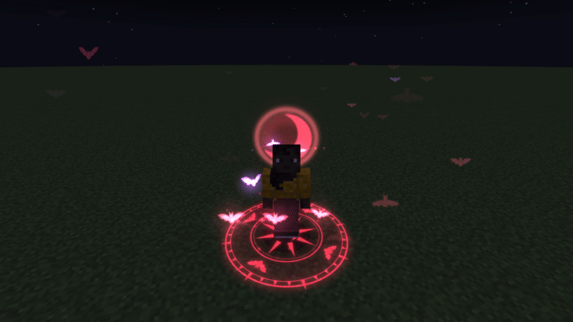

- Minecraft 1.21.1 · Fabric (com Fabric API) ou NeoForge
- Vai no **cliente e no servidor**, e não precisa de nenhum outro mod
- Os jars prontos estão em [Releases](../../releases)

## As auras

| Aura | O que aparece |
|---|---|
| **Elétrica** | Raios estalando pelo corpo, orbes de plasma com rastro, anel elétrico nos pés, descargas no chão e raios caindo do céu |
| **Fogo** | Chamas subindo pelo corpo e num anel nos pés, duas serpentes de fogo em espiral, brasas dançando e fumaça |
| **Lava** | Poça de magma rachada, rochas de magma orbitando e pingando, bolhas que estouram e mini-erupções |
| **Gelo** | Seis cristais de gelo em dois anéis girando ao contrário, neve caindo, névoa fria e mandala de gelo |
| **Sombra** | Vórtice roxo numa poça escura, partículas sugadas para o corpo, fumaça negra e orbes do vazio |
| **Natureza** | Folhas subindo em espiral, pétalas, vaga-lumes e **flores brotando do chão por onde você anda** |
| **Divina** | Auréola dourada, asas de luz batendo, feixes de luz subindo, penas caindo e círculo sagrado |
| **Cósmica** | Três anéis orbitais com planetas, nebulosas coloridas, estrelas piscando e estrelas cadentes |
| **Kokusen** | Raios negros com contorno vermelho estalando nos punhos; a cada 3 s o soco carrega e explode em tentáculos de raio, o chão racha em teia, com clarão e estilhaços pretos |
| **Lorde Vampiro** | Enxame de morcegos astrais batendo as asas, lua de sangue atrás da cabeça, névoa carmesim, gotas de sangue subindo, pétalas de rosa e selo gótico |
| **Necromante** | Ilusões de zumbis, esqueletos, wither skeletons e strays (os modelos do próprio Minecraft, fantasmas) sobem do chão atrás de você e se desfazem em almas; crânios fantasmas e fogo de alma |
| **Pokébola** | Poké, Great, Ultra e Master Ball orbitando; a cada 2,5 s uma abre a tampa e solta um feixe de energia no chão, com brilho shiny e o emblema da Pokébola em neon |

Ao ligar uma aura ela "acende" com um efeito próprio (raio do céu, coluna de fogo, erupção, implosão...).

A aura **Pokébola** usa o modelo 3D, as texturas e os sons das Pokébolas do **Cobblemon** quando ele
está instalado. Sem o Cobblemon ela continua funcionando, com Pokébolas desenhadas pelo próprio mod e
sons do vanilla. O mod não depende do Cobblemon.

| Elétrica | Fogo | Lava |
|---|---|---|
| 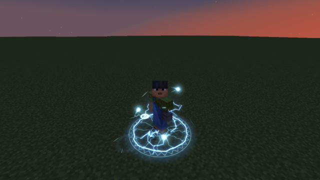 | 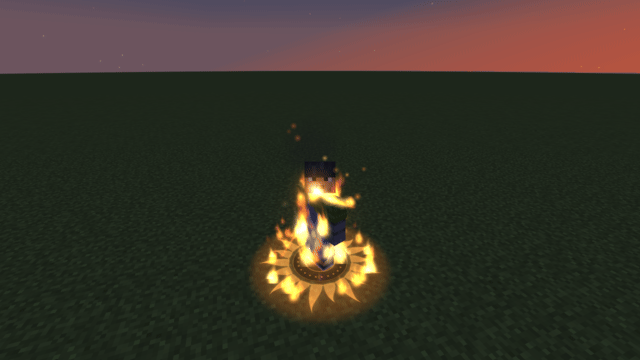 | 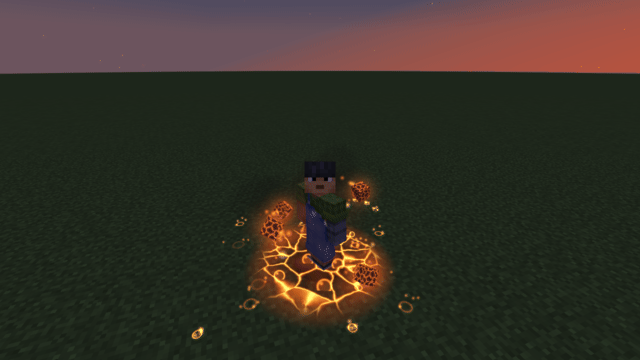 |
| **Gelo** | **Sombra** | **Natureza** |
| 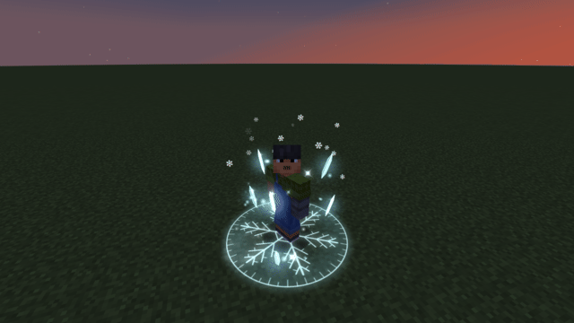 | 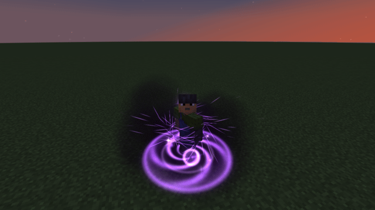 | 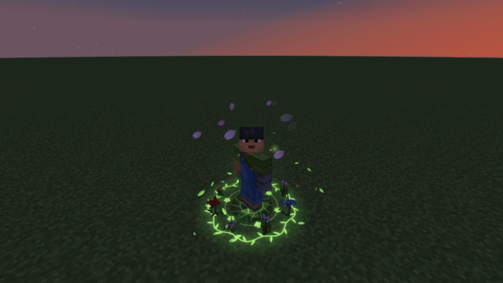 |
| **Divina** | **Cósmica** | **Kokusen** |
| 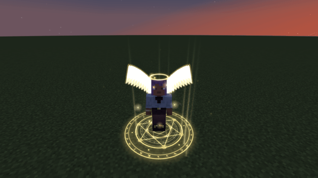 | 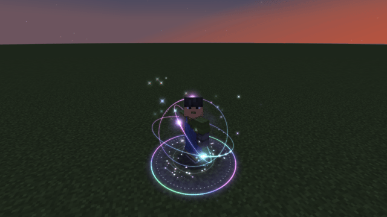 | 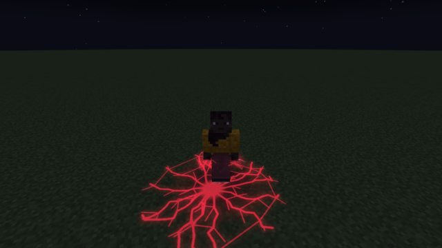 |
| **Lorde Vampiro** | **Necromante** | **Pokébola** |
|  | 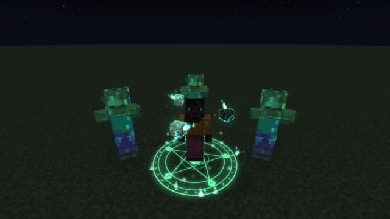 | 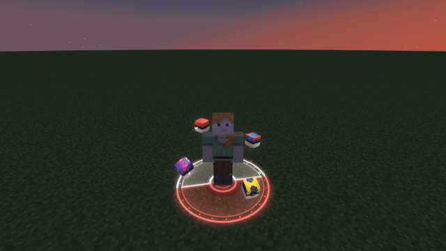 |

## Como usar

- **Tecla `K`** (ou `/aura`) abre o menu: prévia 3D do seu personagem com a aura (arraste para girar),
  escolha, equipe, e ajuste qualidade, auras dos outros e sons.
- `/aura usar <aura>` · `/aura desligar` · `/aura lista`

### Comandos de admin (OP nível 2 por padrão)

| Comando | Faz |
|---|---|
| `/aura dar <jogadores> <aura\|todas>` | Libera a aura para o jogador |
| `/aura tirar <jogadores> <aura\|todas>` | Remove a liberação (e desliga se estiver usando) |
| `/aura definir <jogadores> <aura\|nenhuma>` | Coloca a aura na hora, ignorando liberação |
| `/aura recarregar` | Lê a config de novo |

Ids: `eletrica`, `fogo`, `lava`, `gelo`, `sombra`, `natureza`, `divina`, `cosmica`, `pokebola`, `kokusen`, `vampiro`, `necromante`.

## Configuração

**Servidor** (`config/auras/servidor.json`)

- `precisaLiberar` (padrão `false`): com `true`, cada jogador só usa as auras que um admin liberou com
  `/aura dar`. Serve para vender auras como VIP. Admins sempre podem usar todas.
- `nivelAdmin` (padrão `2`): nível de OP dos comandos de admin.
- `desativadas`: lista de ids que ninguém pode usar.

A aura equipada e as liberadas ficam salvas no mundo (`data/auras.dat`).

**Cliente** (`config/auras/cliente.json`, também muda pelo menu)

- `densidade` 0.25–2 (qualidade), `distancia` (blocos até onde as auras aparecem), `mostrarOutros`,
  `primeiraPessoa` (mostrar sua aura em primeira pessoa), `sons`, `volume`.

## Detalhes

- Invisibilidade esconde a aura. Espectadores e quem está dormindo não mostram aura.
- Longe da câmera as auras soltam menos partículas; cada aura tem limite de partículas.

## Instalação

Coloque o jar do seu loader na pasta `mods` do **cliente e do servidor**. No Fabric precisa do
Fabric API; no NeoForge, só do NeoForge.

Quem entrar no servidor sem o mod consegue jogar normalmente, só não vê as auras.

## Compilar

Precisa de JDK 21 (o Gradle baixa um sozinho se não tiver).

```bash
./gradlew build
```

Os jars saem em `fabric/build/libs/auras-fabric-1.21.1-<versão>.jar` e
`neoforge/build/libs/auras-neoforge-1.21.1-<versão>.jar`.

- `common/`: todo o mod (só Minecraft puro), compilado dentro dos dois loaders
- `fabric/`, `neoforge/`: só a ligação com cada loader (eventos, rede, comandos)
- `ferramentas/GerarTexturas.java`: gera o atlas de efeitos e o ícone (`java ferramentas/GerarTexturas.java`)
- `./gradlew :fabric:runAutoteste` abre um mundo plano, liga cada aura, grava quadros e tira prints
  (código em `common/.../teste/`, que não vai para o jar); `ferramentas/fazer-gifs.sh` monta os GIFs

## Créditos

- Na aura Pokébola, os modelos, as texturas e os sons são lidos do próprio [Cobblemon](https://cobblemon.com)
  quando ele está instalado; nada dele vem dentro do mod.
- Projeto de fã, sem vínculo com Mojang, Microsoft, Cobblemon, Nintendo, Game Freak ou The Pokémon Company.
